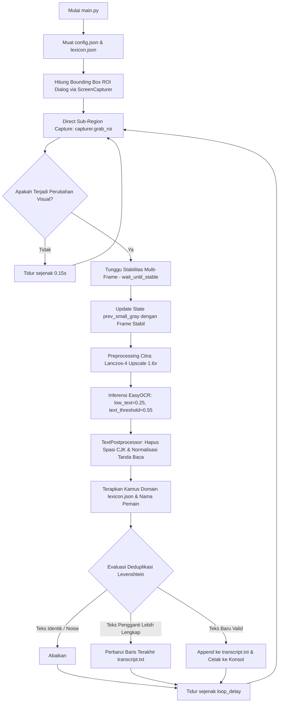

# Hinakoi Story Transcriber (OCR Monitor) v2.1

Alat otomasi berbasis Python untuk mengekstrak dan mentranskripsikan dialog cerita berbahasa Jepang secara *real-time* dari game visual novel **Hinakoi** pada OS Windows tanpa injeksi memori atau modifikasi file game (non-intrusif).

Script ini menggunakan **EasyOCR** yang telah ditala khusus untuk visual novel, dilengkapi dengan **Direct Sub-Region Screen Capture**, **Dynamic Stability Detector** (anti *typewriter cut-off*), **Dual-Layer CJK Post-Processing**, serta **Domain Lexicon** untuk memastikan dialog terekam akurat, bersih tanpa spasi liar, dan bebas duplikasi.

---

## 🌟 Fitur Unggulan (v2.1)

- **Direct Sub-Region Capture:** Menangkap koordinat kotak dialog secara langsung via `mss`, menghemat alokasi memori RAM dan beban CPU hingga ~70% dibanding capture layar penuh.
- **Dynamic Stability & Anti-Typewriter Effect:** Memastikan seluruh teks selesai diketik (stabil multi-frame berturut-turut) sebelum inferensi dijalankan, mengeliminasi teks terpotong prematur di tengah kalimat.
- **Tuned EasyOCR for VN:** Dikonfigurasi dengan ambang batas sensitif (`low_text=0.25`, `text_threshold=0.55`) agar titik-titik elipsis (`……` atau `......`) dan karakter berbayang tetap terdeteksi dengan jelas.
- **CJK Whitespace Cleaning:** Menghapus spasi acak antar karakter kanji dan kana tanpa merusak spasi kata alfabet/Latin.
- **Auto-Balancing Quotes & Brackets:** Menyeimbangkan tanda kutip dialog (`「...」`) dan kurung monolog batin (`（...）`), serta memperbaiki tanda kutip yang tertelan ke depan nama karakter.
- **Domain Lexicon & Kanji Auto-Correction:** Kamus regex otomatis untuk memperbaiki kanji yang rentan salah baca secara visual (seperti `僕`, `傘の先輩`, `後輩`, `天真爛漫`, `小首を傾げる`, `経緯`, `呟いた`, `困ったら`).
- **Normalisasi Nama Pemain Fleksibel:** Otomatis mengubah variasi nama akun pemain (`THEKONZ`, `THEKONz`, `THE先輩`) menjadi `PLAYER_NAME` secara seragam.
- **Deduplikasi Levenshtein:** Mencegah pencatatan ganda akibat kedipan render (*flicker*) dan otomatis memperbarui baris jika tertangkap teks kelanjutan yang lebih lengkap.

---

## 🏗️ Diagram Alur Kerja Pipeline



---

## 📁 Struktur Direktori Proyek

```text
hinakoi-ocr-monitor-windows/
├── .gitignore              # Mengabaikan virtual environment, cache, dan data transkrip
├── config.json             # Konfigurasi terpusat (monitor, ROI, stability, player name)
├── lexicon.json            # Kamus domain Hinakoi (aturan regex kanji & daftar karakter)
├── requirements.txt        # Daftar pustaka Python pendukung
├── README.md               # Dokumentasi utama proyek
├── main.py                 # File eksekusi utama berarsitektur modular
├── src/                    # Modul pipeline
│   ├── __init__.py
│   ├── capture.py          # ScreenCapturer: Sub-region capture mss native
│   ├── stability.py        # StabilityDetector: Deteksi perubahan & stabilitas multi-frame
│   ├── preprocessor.py     # ImagePreprocessor: Upscaling Lanczos-4 & optimasi citra
│   ├── ocr_engine.py       # BaseOCREngine, EasyOCREngine (tuned), MangaOCREngine
│   └── postprocessor.py    # TextPostprocessor: Pembersihan CJK, quote repair, lexicon & deduplikasi
├── tests/
│   └── evaluate_accuracy.py # Skrip benchmark evaluasi CER multi-bab
└── transcript/
    └── transcript.txt      # Tempat penyimpanan output transkripsi real-time
```

---

## 📋 Prasyarat

1. **OS Windows 10/11** dengan Python 3.8 atau lebih baru.
2. **Perangkat Android & scrcpy** (untuk *screen mirroring* HP fisik) ATAU **Emulator Android** (LDPlayer, BlueStacks, dsb).
3. *(Opsional)* **NVIDIA GPU** dengan CUDA terinstal untuk akselerasi EasyOCR yang jauh lebih cepat.

---

## 🛠️ Instalasi

1. **Clone repositori:**
   ```bash
   git clone https://github.com/yusufadji/hinakoi-ocr-monitor-windows.git
   cd hinakoi-ocr-monitor-windows
   ```

2. **Buat & aktifkan virtual environment:**
   ```powershell
   python -m venv .venv
   .venv\Scripts\activate
   ```

3. **Install dependensi:**
   ```bash
   pip install -r requirements.txt
   ```

4. *(Opsional untuk GPU NVIDIA)* **Install PyTorch CUDA:**
   ```bash
   pip install torch torchvision --index-url https://download.pytorch.org/whl/cu118
   ```

---

## ⚙️ Konfigurasi (`config.json`)

Seluruh parameter operasional diatur terpusat di `config.json` tanpa perlu mengubah kode sumber:

```json
{
  "monitor_index": 2,
  "crop_regions": {
    "subtitle": {
      "top_ratio": 0.68,
      "bottom_ratio": 0.93,
      "left_ratio": 0.06,
      "right_ratio": 0.94
    }
  },
  "ocr_engine": "easyocr",
  "fallback_engine": "easyocr",
  "upscale_factor": 1.6,
  "change_threshold": 40000,
  "stability": {
    "stable_threshold": 1.5,
    "consecutive_stable_frames": 3,
    "check_interval": 0.15,
    "max_wait_seconds": 3.0
  },
  "loop_delay": 0.25,
  "destination": "transcript",
  "player_name_replacement": {
    "enabled": true,
    "source_name": "THEKONZ",
    "target_placeholder": "PLAYER_NAME"
  }
}
```

| Parameter | Deskripsi |
| :--- | :--- |
| `monitor_index` | Pilihan monitor tempat game berjalan (1 = Monitor Utama, 2 = Monitor Kedua). |
| `crop_regions.subtitle` | Rasio persentase area kotak dialog (disetel default untuk rasio 16:9). |
| `ocr_engine` | Engine OCR yang digunakan (`"easyocr"` direkomendasikan untuk dialog horizontal). |
| `stability.consecutive_stable_frames` | Jumlah frame stabil berturut-turut sebelum teks diekstrak (anti-typewriter). |
| `player_name_replacement` | Otomatis mengganti nama akun game Anda menjadi `PLAYER_NAME`. |

---

## 📖 Kamus Domain (`lexicon.json`)

File `lexicon.json` memungkinkan penambahan aturan perbaikan kanji baru kapan saja tanpa menyentuh logika program. Anda dapat menambahkan pola regex pada array `regex_replacements` atau mendaftarkan nama karakter baru ke `characters`.

---

## 🚀 Cara Penggunaan

1. **Posisikan Game**: Buka game Hinakoi melalui `scrcpy` atau Emulator di monitor yang dipilih (misal Monitor 2) dalam mode Fullscreen / Maximize.
2. **Jalankan Program**:
   ```powershell
   python main.py
   ```
3. **Melihat Hasil**:
   - Setiap dialog baru akan dicetak ke konsol terminal lengkap dengan *timestamp*.
   - Transkrip bersih otomatis tersimpan di `transcript/transcript.txt`.
4. **Menghentikan Program**: Tekan `Ctrl + C` pada terminal untuk menghentikan program dengan aman.

---

## 📊 Hasil Evaluasi Akurasi (Benchmark)

Berdasarkan pengujian multi-bab menggunakan `tests/evaluate_accuracy.py`:

| Dataset Cerita | CER Awal | CER Pipeline v2.1 | Penurunan Error |
| :--- | :--- | :--- | :--- |
| **Bab 1: 傘の先輩-2** | 37.21% | **16.56%** | **55.48%** |
| **Bab 2: バイオレット-1** | 22.33% | **13.96%** | **37.50%** |

---

## ⚠️ Batasan & Catatan Penting

- **UI Display Scaling Windows:** Pastikan pengaturan *Display Scaling* pada Windows untuk monitor target disetel ke **100%**. Jika lebih dari itu (misal 125%), koordinat penangkapan layar `mss` dapat bergeser.
- **Format Horizontal VN:** Sistem dioptimalkan untuk dialog horizontal game Hinakoi.

---

## 📜 Disclaimer

Proyek ini adalah alat *fan-made* dan tidak berafiliasi, dikelola, atau didukung oleh *developer* maupun *publisher* dari game Hinakoi. Gunakan script ini secara bertanggung jawab dan murni untuk keperluan pribadi.
